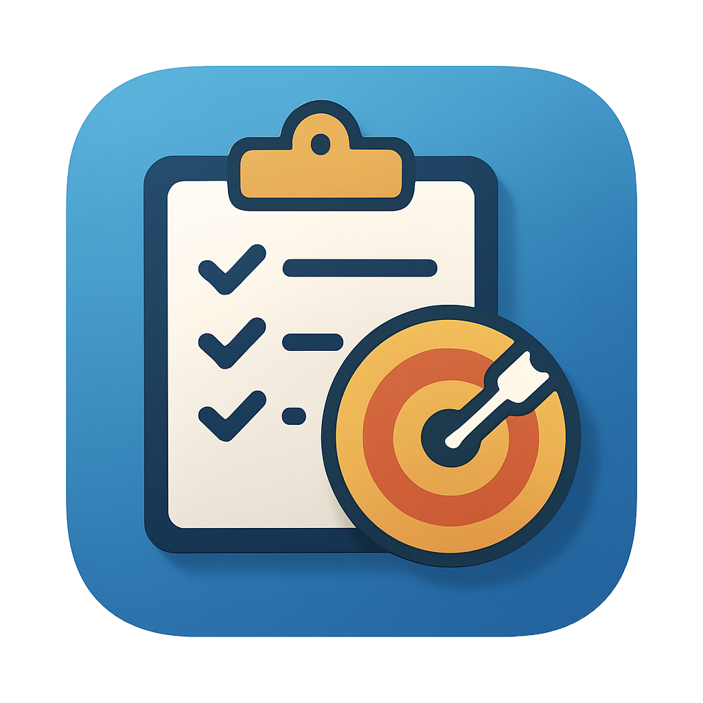
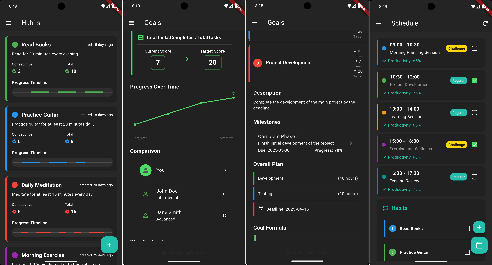
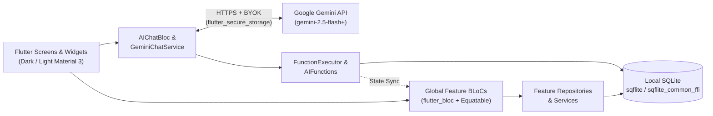

<div align="center">



# Life Wizard

### **Your Local-First, Agentic AI Life Operating System.**
**Turn goals into math-backed roadmaps, days into timeboxed deep work, and an AI coach into an operator that executes directly inside your database.**

[](LICENSE)
[](https://flutter.dev)
[](https://dart.dev)
[](https://aistudio.google.com/)
[](CONTRIBUTING.md)

[Features](#-why-life-wizard-hits-different) • [Screenshots](#-inside-the-app) • [Architecture](#-under-the-hood) • [Quick Start](#-5-minute-quick-start) • [AI-Ready Repo](#-built-for-contributors--ai-coding-agents) • [Contributing](CONTRIBUTING.md)

</div>

---

## ⚡ Why Life Wizard?

Most productivity tools trap you in **tab sprawl**: one app for tasks, another for habits, a timer for focus, a spreadsheet for goals, and a generic AI chatbot that forgets everything you care about.

**Life Wizard unifies your entire execution loop in one offline-first Flutter app—and wires a Gemini AI coach directly into your local SQLite database.**

Tell the assistant: *"Break my launch goal into milestones, schedule a 90-minute deep-work block at 9 AM, and mark my reading habit done"*—and it doesn't just give advice. It **executes structured tool calls** against your goals, habits, todos, and daily schedule in real time, with your explicit confirmation before any destructive action.

| Capability | Typical To-Do App | Generic AI Chatbot | **Life Wizard** |
| :--- | :---: | :---: | :---: |
| **Local-First SQLite Storage (Zero Cloud Lock-in)** | ⚠️ Rare | ❌ Cloud only | ✅ On-device SQLite (`sqflite` / `FFI`) |
| **Agentic AI Tool Calling (Mutates Goals, Habits & Schedule)** | ❌ | ❌ Advice only | ✅ 15+ structured DB tools |
| **Bring Your Own Key (OS-Encrypted Storage)** | ❌ | ❌ Subscription | ✅ `flutter_secure_storage` + Gemini |
| **Timeboxing + Productivity Heatmaps + Habit Sync** | ❌ | ❌ | ✅ Unified daily execution |
| **Schedule-Synced Focus Clock + Pomodoro + Voice TTS** | ❌ | ❌ | ✅ Dual-mode Pro Clock + Audio/TTS |
| **Math-Backed Goal Formulas & Milestone Roadmaps** | ❌ | ❌ | ✅ Score tracking & charts |
| **Cross-Platform (Mobile + Desktop + Web)** | ⚠️ Often limited | ✅ | ✅ Flutter multi-platform |

---

## 📱 Inside the App

<div align="center">
  
</div>

> **From left to right:**
> 1. **Habits** — Visual progress timelines, consecutive streaks, total completions, and color-coded daily disciplines.
> 2. **Goals & Benchmarks** — Formula-driven goal scoring (`totalTasksCompleted / totalTasks`), current-vs-target score cards, time-series progress charts, and benchmark comparisons.
> 3. **Goal Roadmaps** — Multi-phase milestones with due dates, completion percentages, hour budgets, and deadlines.
> 4. **Timeboxed Schedule** — `HH:MM - HH:MM` focus blocks tagged `Challenge` or `Regular`, per-block productivity scores, and quick-toggle daily habits at the bottom.

---

## ✨ Why Life Wizard Hits Different

### 🤖 Agentic Gemini AI Life Coach (Not Just Chat)
- **Real Tool Execution**: Uses structured `<function_call>` execution (`FunctionExecutor` → `AIFunctions`) to read, create, update, and delete **todos, habits, goals, roadmaps, and schedule timeboxes** directly inside your local SQLite database.
- **Mood-Aware Context**: Automatically injects your latest mood check-in data and custom `<user_guidelines>` into the system prompt so coaching adapts to your actual energy and rules.
- **Dynamic Model Discovery & BYOK Privacy**: Bring your own free or paid Gemini API key (stored securely via `flutter_secure_storage`), fetch live available models from `/v1beta/models` (defaults to `gemini-2.5-flash`), and switch models anytime in Settings.
- **Safety First**: Error payloads strip and mask API keys (`GeminiChatService.sanitizeErrorText`), and deletions require confirmation before modifying your data.

### 📅 Timeboxed Schedule & Productivity Heatmaps
- Plan your day in crisp `HH:MM - HH:MM` blocks tagged as **Challenge** or **Regular**.
- Track block-level todos, notes, completion status, and **heatmap productivity scores**.
- Sync daily habits directly onto your schedule view so you check everything off from one command center.

### 🎯 Goal Formulas, Roadmaps & Progress Charts
- Define **start, current, and target scores** with formula expressions and visual progress-over-time charts.
- Break ambitious goals into **structured milestones** with deadlines, phase hour allocations, and completion percentages.
- Benchmark your momentum against target levels with comparison cards.

### ⏱️ Pro Clock — Dual-Mode Deep Work Engine
- **Schedule Mode**: Automatically loads your active timeboxed task for the day and counts down the exact block duration.
- **Pomodoro Mode**: Switch seamlessly into configurable work/break focus phases without losing your schedule timer state.
- **Audio Alarms & Voice Cues**: Plays alarm audio (`alarm.mp3`) and announces phase/task transitions via **Text-to-Speech** (`flutter_tts`).

### 🔥 Habits, Streaks, Mood & Gamified Momentum
- **Habit Timelines**: Track consecutive streaks and total completions across Schedule and Habits views.
- **Mood Check-ins**: Answer configurable reflective questions that sharpen your AI coach's context.
- **Gamification Engine**: Automatically earn **Points**, **Hours Worked**, **Badges**, and **Cookie Jar** entries as you complete tasks, habits, and scheduled deep-work blocks.
- **Stoic Wisdom & Smart Notifications**: Curated Stoic & discipline quotes on launch plus 7-day rolling local notification scheduling on mobile.

---

## 🏗️ Under the Hood

Life Wizard is engineered with a clean, **feature-first BLoC + Repository** architecture and an embedded **SQLite** database (`life_wizard.db`):



<details>
<summary><strong>📂 Project Structure (Click to expand)</strong></summary>

```text
lib/
├── main.dart                     # Bootstrap, desktop SQLite FFI init, global BLoCs & routes
├── database_initializer.dart     # SQLite schema (v2), migrations & YYYY-MM-DD date normalization
├── assets/                       # App icon & alarm audio asset
├── utils/
│   ├── alarm_utils.dart          # Audio alarm + flutter_tts spoken announcements
│   ├── notification_utils.dart   # Timezone-aware local mobile notifications
│   ├── stoic_quotes.dart         # Curated Stoic & discipline quote bank
│   └── theme_utils.dart          # Dynamic dark/light theme helpers
├── widgets/
│   ├── app_drawer.dart           # Navigation drawer with live Points & Hours Worked
│   └── loading_screen.dart       # Animated launch screen with daily quote
└── features/
    ├── ai_chat/                  # AIChatBloc, GeminiChatService, structured cards & chat UI
    ├── ai_prompting/             # SystemPrompt, MessageFormatter, AIFunctions & FunctionExecutor
    ├── goals/                    # Goal formulas, milestones, charts & roadmaps
    ├── habits/                   # Streaks, total progress & timelines
    ├── mood_data/                # Reflective mood Q&A & AI context injection
    ├── pro_clock/                # Dual-mode Schedule + Pomodoro timer
    ├── progress_dashboard/       # PointsService & RewardRepository (points, badges, cookie jar)
    ├── schedule/                 # Timeboxes, challenge tags & heatmap productivity
    ├── settings/                 # Theme, language, notifications, AI guidelines & secure API key
    └── todo/                     # Prioritized task manager
```

</details>

---

## 🚀 5-Minute Quick Start

### Prerequisites
- **Flutter SDK** (`Dart SDK >=3.7.2 <4.0.0`) — [Install Flutter](https://docs.flutter.dev/get-started/install)
- A free **Gemini API Key** from [Google AI Studio](https://aistudio.google.com/) *(optional—required only for AI coaching)*

### Run Locally

```bash
# 1. Clone the repository
git clone https://github.com/Majidi-star/Life-Wizard.git
cd Life-Wizard

# 2. Install dependencies
flutter pub get

# 3. Run static analysis & tests (optional sanity check)
flutter analyze
flutter test

# 4. Launch on your target device (Android, iOS, Windows, macOS, Linux, or Web)
flutter run
```

### Enable the AI Coach
1. Open the navigation drawer → **Settings**.
2. Paste your **Gemini API Key** (encrypted locally with `flutter_secure_storage`—never leaves your device except for direct Gemini API requests).
3. Choose your preferred Gemini model (defaults to `gemini-2.5-flash`) and add any personal **AI Guidelines**.
4. Head back to **AI Chat** and start commanding your goals, habits, todos, and daily schedule!

> **Desktop Note:** Windows, Linux, and macOS automatically initialize `sqflite_common_ffi` at startup—no extra SQLite setup required.

---

## 🤖 Built for Contributors & AI Coding Agents

Want to hack on Life Wizard or extend it with your favorite AI coding tool? This repo ships pre-configured agent context out of the box:

- **Claude Code**: [`CLAUDE.md`](CLAUDE.md) & [`.claude/rules/flutter-architecture.md`](.claude/rules/flutter-architecture.md)
- **Antigravity / Gemini**: [`GEMINI.md`](GEMINI.md), [`.agents/rules/`](.agents/rules/), & [`.agents/skills/`](.agents/skills/)
- **Universal Agents**: [`AGENTS.md`](AGENTS.md)
- **Human Contributors**: [`CONTRIBUTING.md`](CONTRIBUTING.md)

---

## 🗺️ Roadmap & Ideas for Contributors

Contributions of all sizes are welcome! High-impact areas to jump into:

- [ ] **Expanded Unit & Widget Tests** across BLoCs, repositories, and `AIFunctions`
- [ ] **Export / Backup & Sync** (JSON/Markdown export of goals, habits, and mood logs)
- [ ] **Localization & Multi-Language UI**
- [ ] **Custom Pomodoro Presets & Ambient Focus Sounds**
- [ ] **CI/CD Workflows** (automated `flutter analyze`, `flutter test`, and release builds)

See [CONTRIBUTING.md](CONTRIBUTING.md) to get started with your first PR.

---

## 🤝 Contributing

We love pull requests, bug reports, and feature proposals! Check out our [Contributing Guide](CONTRIBUTING.md) for setup instructions, architecture conventions, commit guidelines, and our PR checklist.

---

## 📄 License

Life Wizard is open-source software licensed under the **Apache License 2.0**. See [LICENSE](LICENSE) for details.

---

<div align="center">

**If Life Wizard inspires your workflow or codebase, drop a ⭐ on the repo—it helps more builders discover the project!**

</div>
